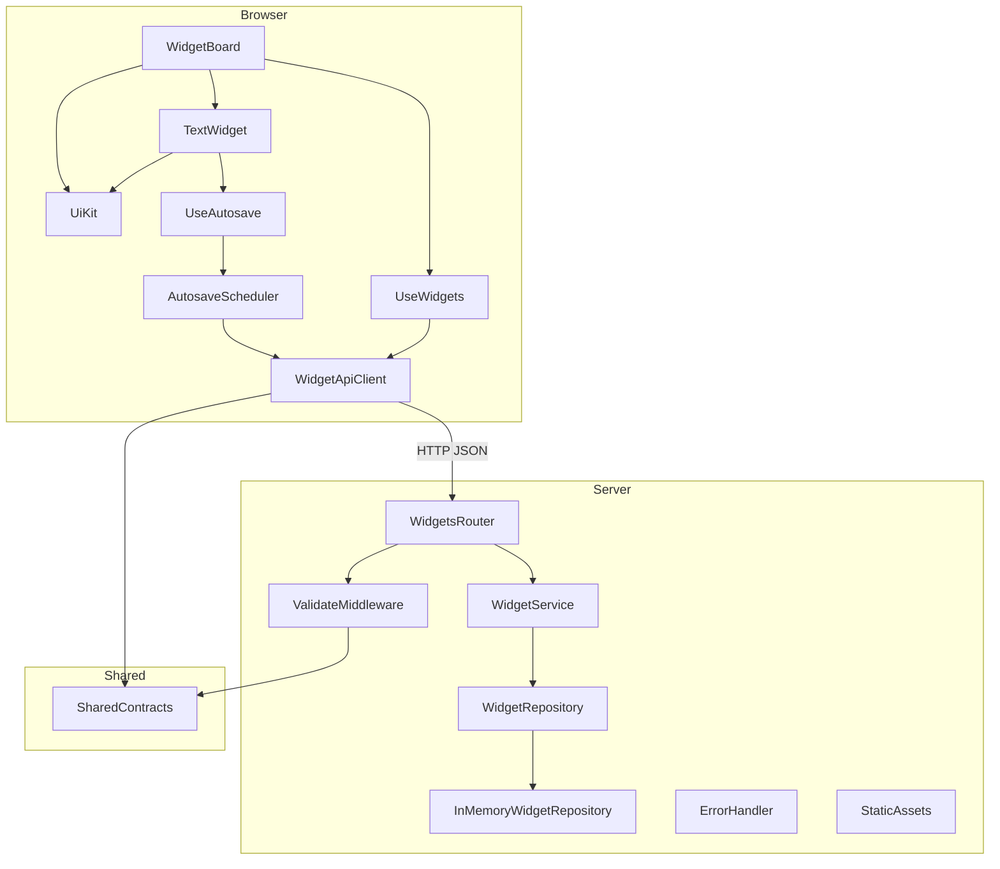
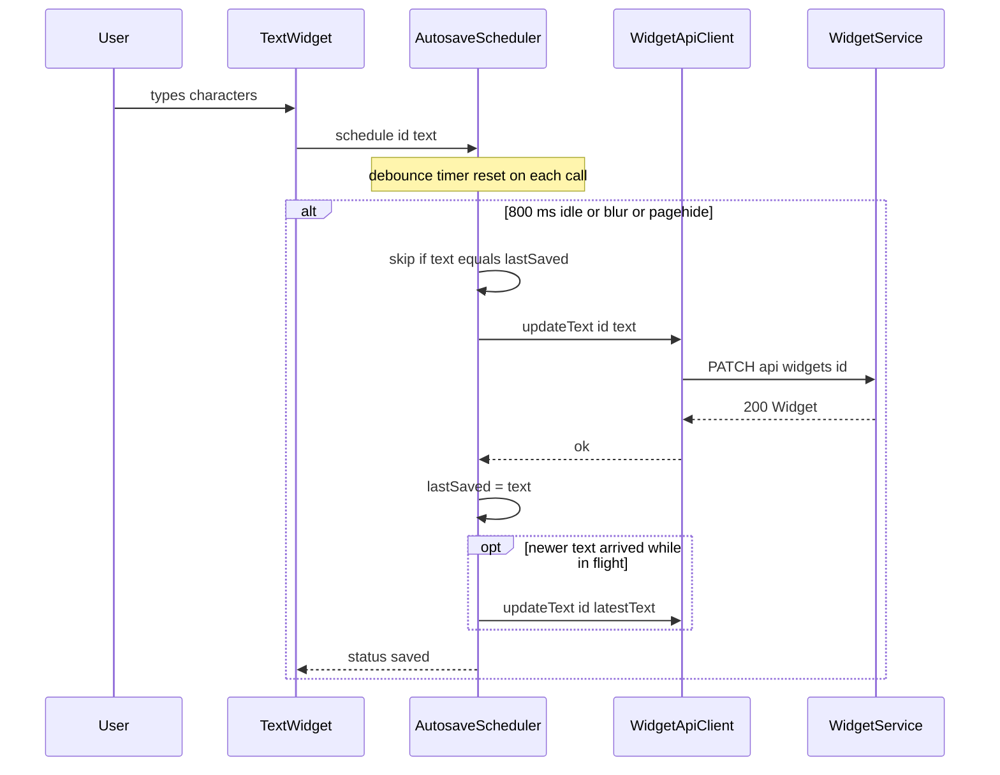
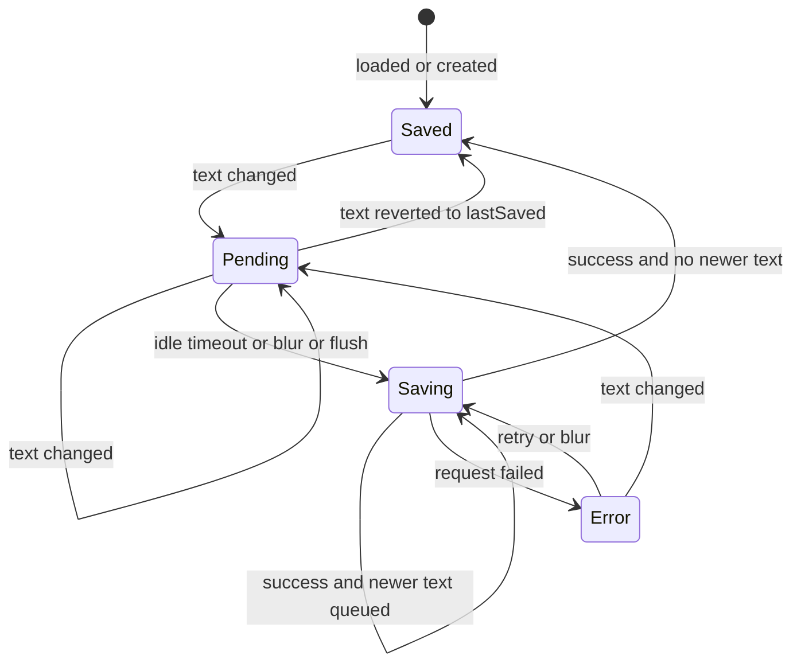

# Design Document

## Overview
**Purpose**: This feature delivers a minimal "pod" page on which a seller adds independent plain-text widgets. Each widget's content is saved automatically to a backend when the user stops typing, and is restored after a page reload.

**Users**: Sellers customising a pod use it to add, edit and remove text blocks. Reviewers of the Trumpet technical challenge use the repository, tests and README to evaluate correctness, efficiency, code quality, testing and documentation.

**Impact**: Greenfield. This creates a TypeScript monorepo containing a React single-page app (Widget App), an Express REST API (Widget Service), a shared contract package, unit tests, Docker packaging and a README.

### Goals
- Add, edit and delete independent bordered text widgets, with autosave on "done typing" and full restore on reload (Reqs 1–6).
- Typing in one widget costs O(1) work regardless of how many widgets exist. Server lookup, update and delete are O(1) (Reqs 5.6, 7.5).
- Reusable UI primitives, a layered and testable backend, and a single shared source of truth for types and limits (Reqs 7, 8).
- One-command test run, one-command Docker start, and a README covering approach, tradeoffs and future work (Reqs 9, 10).

### Non-Goals
- Rich-text formatting, fonts or other widget types (only the container is made reusable for them).
- Authentication, multiple pods/users, or multi-tab conflict resolution.
- Durable storage across server restarts (in-memory only, behind a swappable repository port).
- Real-time collaboration, drag-and-drop reordering, end-to-end browser tests.

## Architecture

### Architecture Pattern & Boundary Map



**Architecture Integration**:
- **Selected pattern**: A single-page app talks to a layered REST API (router → service → repository port and adapter). A shared contract package is used by both. Alternatives are recorded in `research.md`.
- **Domain/feature boundaries**:
  - `packages/shared` owns the `Widget` type, request schemas, error codes and `MAX_TEXT_LENGTH`. It has no runtime dependencies other than zod.
  - `apps/server` owns persistence and validation. HTTP concerns stay in the router and middleware. Business rules live in the service. Storage sits behind `WidgetRepository`.
  - `apps/web` owns presentation and client-side save orchestration. The autosave logic is framework-agnostic (`AutosaveScheduler`) and React binds to it through hooks.
- **Existing patterns preserved**: None (greenfield). No steering documents exist.
- **New components rationale**: Each component maps to one responsibility in the summary table below. The scheduler is separated from React so it can be unit-tested with fake timers.

### Technology Stack

| Layer | Choice / Version | Role in Feature | Notes |
|-------|------------------|-----------------|-------|
| Language | TypeScript ~6.0.3 (strict) | All packages | TS 7 native compiler avoided for tooling compatibility; `tsc --noEmit` used for type checks only |
| Frontend | React 19.3, Vite 8.3, @vitejs/plugin-react 6.1 | SPA, dev server with `/api` proxy | Plain CSS, no UI library (minimal styling, Req 8.4) |
| Backend | Node.js ≥ 22.12 (Docker: node:24-alpine), Express 5.3 | REST API and static asset hosting in production | Express 5 propagates async errors to the error handler natively |
| Validation | zod 4.6 | Shared request schemas, used by the server and for client-side typing | |
| Data / Storage | In-memory `Map<WidgetId, Widget>` | Widget persistence for the lifetime of the process | Insertion order gives creation order; O(1) access |
| Testing | Vitest 5.0, @testing-library/react 16.3, user-event 14.6, jsdom 28, supertest 7.3 | Unit and component tests for all packages | jsdom pinned to 28.x because of the Node 22.12 engine constraint |
| Dev runtime | tsx 4.23, npm workspaces, concurrently | Run server in watch mode; one `npm run dev` | |
| Infrastructure | Docker multi-stage build, docker compose | Single container serving SPA and API on port 3000 | Bonus Req 10.7 |

## System Flows

### Autosave of a single widget



**Key decisions**:
- At most one save is in flight per widget. Text typed during a save is coalesced into exactly one follow-up save, so the last typed text is always the final stored value (3.6).
- Blur calls `flush(id)` immediately (3.2). `pagehide` and `visibilitychange: hidden` call `flushAll({ keepalive: true })` so a reload inside the debounce window loses nothing (4.2).
- A failed save leaves the widget dirty with status `error`. The next keystroke, blur or the Retry action re-attempts it.

### Save status lifecycle



### Load, add and delete
- **Load (4.1–4.5)**: `useWidgets` calls `GET /api/widgets` on mount. State moves `loading → ready | error`, and the error state renders an `Alert` with a Retry button that re-runs the load. Each returned widget seeds `scheduler.markSaved(id, text)`.
- **Add (1.2–1.5)**: Each click calls `POST /api/widgets` independently. On `201` the widget is appended to the board list. A failure shows a dismissible `Alert`. The add button shows a pending count but stays enabled (1.3).
- **Delete (6.2–6.6)**: The widget's draft is captured with `scheduler.peek(id)` and its pending save is cancelled with `scheduler.cancel(id)`. The widget is hidden optimistically, and then `DELETE /api/widgets/:id` is called. On failure the widget reappears in its original position with its latest draft (the scheduler baseline is restored and unsaved edits are rescheduled), and an `Alert` is shown. A `404` counts as success because the widget is already gone.

## Requirements Traceability

| Requirement | Summary | Components | Interfaces | Flows |
|-------------|---------|------------|------------|-------|
| 1.1, 1.2, 1.3 | Add button, one widget per click | WidgetBoard, Button, useWidgets | `WidgetApi.create`, `POST /api/widgets` | Load, add and delete |
| 1.4 | Append in creation order | useWidgets, InMemoryWidgetRepository | `WidgetRepository.list` | — |
| 1.5 | Persist on creation | WidgetService | `POST /api/widgets` | — |
| 1.6 | Visible border | WidgetFrame | `WidgetFrameProps` | — |
| 1.7 | Empty state | WidgetBoard | — | — |
| 2.1, 2.4, 2.5 | Plain-text input preserving whitespace | TextArea, TextWidget | `TextAreaProps` | — |
| 2.2, 2.3 | Independent text per widget | TextWidget (local draft state) | `useAutosave` | — |
| 3.1–3.6 | Debounce, blur flush, coalescing, skip unchanged | AutosaveScheduler, useAutosave | `AutosaveScheduler` | Autosave |
| 3.7 | Store text, return widget | WidgetService, WidgetsRouter | `PATCH /api/widgets/:id` | Autosave |
| 3.8 | Per-widget save status | StatusIndicator, useAutosave | `SaveStatus` | Save status lifecycle |
| 4.1–4.5 | Load, order, loading and error with retry | useWidgets, WidgetBoard, Alert | `GET /api/widgets` | Load, add and delete |
| 4.6 | In-memory retention | InMemoryWidgetRepository | `WidgetRepository` | — |
| 5.1–5.3 | ≥ 10,000 chars; 1,000-char round-trip | TextArea, shared constants, ValidateMiddleware | `MAX_TEXT_LENGTH = 50_000` | — |
| 5.4 | Reject over-limit, keep previous text | ValidateMiddleware, WidgetService | 400 `VALIDATION_ERROR`, 413 | — |
| 5.5 | Unicode round-trip | WidgetApiClient, Express JSON (UTF-8) | — | — |
| 5.6 | Responsive with large text | TextWidget memoisation, local state | — | — |
| 6.1–6.6 | Delete control, optimistic removal, rollback, cancel pending save | WidgetFrame, Button, useWidgets, AutosaveScheduler | `DELETE /api/widgets/:id`, `scheduler.cancel` | Load, add and delete |
| 7.1–7.6 | CRUD API, model, 404, 400, O(1), JSON | WidgetsRouter, WidgetService, InMemoryWidgetRepository, ErrorHandler | API contract | — |
| 8.1–8.5 | Reusable Button, TextArea, WidgetFrame; minimal CSS; a11y labels | UI kit | Base props | — |
| 9.1–9.5 | Server, web, 1,000-char and component tests; single command | Test suites | `npm test` | — |
| 10.1–10.8 | README, Git history, Docker, publishable | Repository root | `docker compose up` | — |

## Components and Interfaces

| Component | Domain/Layer | Intent | Req Coverage | Key Dependencies (P0/P1) | Contracts |
|-----------|--------------|--------|--------------|--------------------------|-----------|
| SharedContracts | Shared | Types, schemas, constants, error codes | 5.1, 5.3, 7.2, 7.6 | zod (P0) | Service |
| InMemoryWidgetRepository | Server / Data | O(1) ordered storage | 1.4, 4.6, 7.5 | — | Service |
| WidgetService | Server / Domain | Widget lifecycle rules | 1.5, 3.7, 6.3, 7.1, 7.3 | WidgetRepository (P0), Clock, IdGenerator (P1) | Service |
| WidgetsRouter + ValidateMiddleware | Server / HTTP | REST endpoints and request validation | 5.4, 7.1, 7.3, 7.4, 7.6 | WidgetService (P0), SharedContracts (P0) | API |
| ErrorHandler | Server / HTTP | Uniform error envelope | 5.4, 7.3, 7.4 | — | API |
| createApp | Server / Composition | Wire dependencies, JSON limit, static hosting | 7.6, 10.7 | All server components (P0) | Service |
| WidgetApiClient | Web / Data | Typed fetch wrapper returning `Result` | 3.7, 4.1, 6.2 | SharedContracts (P0) | Service |
| AutosaveScheduler | Web / Logic | Debounce, flush, coalesce, cancel, status | 3.1–3.6, 3.8, 6.6 | WidgetApiClient (P0) | Service, State |
| useAutosave | Web / Hook | Bind a widget to the scheduler | 2.2, 3.8 | AutosaveScheduler (P0) | State |
| useWidgets | Web / Hook | Board list: load, add, delete with rollback | 1.2–1.5, 4.1–4.5, 6.2–6.5 | WidgetApiClient (P0), AutosaveScheduler (P1) | State |
| WidgetBoard | Web / UI | Page layout, add button, empty, loading and error states | 1.1, 1.7, 4.4, 4.5 | useWidgets (P0) | — |
| TextWidget | Web / UI | One bordered, independently editable widget | 1.6, 2.1–2.5, 3.8, 6.1 | useAutosave (P0), UI kit (P0) | — |
| UI kit: Button, TextArea, WidgetFrame, StatusIndicator, Alert | Web / UI | Reusable primitives | 8.1–8.5 | — | — |

### Shared

#### SharedContracts (`packages/shared`)

| Field | Detail |
|-------|--------|
| Intent | Single source of truth for the widget model, limits and API payloads |
| Requirements | 5.1, 5.3, 7.2, 7.6 |

**Contracts**: Service [x]

```typescript
type WidgetId = string; // UUID v4, server-generated
type IsoDateTime = string; // ISO 8601 UTC

interface Widget {
  id: WidgetId;
  text: string;
  createdAt: IsoDateTime;
  updatedAt: IsoDateTime;
}

const MAX_TEXT_LENGTH = 50_000; // UTF-16 code units (matches textarea maxlength)

// zod schemas; inferred types exported alongside
// CreateWidgetRequest  = { text?: string }       (max MAX_TEXT_LENGTH, default "")
// UpdateWidgetRequest  = { text: string }        (max MAX_TEXT_LENGTH)
// WidgetIdParams       = { id: string (uuid) }

interface ListWidgetsResponse { widgets: Widget[] }

type ApiErrorCode = 'VALIDATION_ERROR' | 'NOT_FOUND' | 'PAYLOAD_TOO_LARGE' | 'INTERNAL_ERROR';

interface ApiErrorBody {
  error: {
    code: ApiErrorCode;
    message: string;
    details?: ReadonlyArray<{ path: string; message: string }>;
  };
}
```
- Invariants: `text.length <= MAX_TEXT_LENGTH` and `updatedAt >= createdAt`.

### Server

#### InMemoryWidgetRepository

| Field | Detail |
|-------|--------|
| Intent | Store widgets in creation order with constant-time keyed access |
| Requirements | 1.4, 4.6, 7.5 |

**Contracts**: Service [x]

```typescript
interface WidgetRepository {
  list(): Widget[];                       // creation order, O(n)
  get(id: WidgetId): Widget | undefined;  // O(1)
  insert(widget: Widget): void;           // O(1), appends; throws on duplicate id
  update(widget: Widget): boolean;        // O(1), keeps position; false if missing (never inserts)
  delete(id: WidgetId): boolean;          // O(1), true if existed
}
```
- Backed by `Map<WidgetId, Widget>`. Map insertion order gives creation order, and `set` on an existing key keeps its position.
- Returns copies, never internal references, so callers cannot mutate stored state.
- Synchronous by design. The interface can be made async later when a DB adapter is introduced. The service already awaits nothing from it, so the change stays local.

#### WidgetService

| Field | Detail |
|-------|--------|
| Intent | Apply widget lifecycle rules independently of HTTP |
| Requirements | 1.5, 3.7, 6.3, 7.1, 7.3 |

**Dependencies**
- Outbound: WidgetRepository — persistence (P0)
- Outbound: `Clock` (`() => Date`) and `IdGenerator` (`() => WidgetId`, default `crypto.randomUUID`). These are injected so tests are deterministic (P1).

**Contracts**: Service [x]

```typescript
type ServiceError = { kind: 'NOT_FOUND'; id: WidgetId };
type ServiceResult<T> = { ok: true; value: T } | { ok: false; error: ServiceError };

interface WidgetService {
  list(): Widget[];
  create(input: { text: string }): Widget;
  updateText(id: WidgetId, text: string): ServiceResult<Widget>;
  delete(id: WidgetId): ServiceResult<void>;
}
```
- Preconditions: input has already been validated against the shared schemas by the HTTP layer.
- Postconditions: `create` sets `createdAt = updatedAt = now`. `updateText` sets `text` and `updatedAt = now`, keeping `id`, `createdAt` and position. A rejected request never mutates state (5.4, 7.4).

#### WidgetsRouter, ValidateMiddleware, ErrorHandler

| Field | Detail |
|-------|--------|
| Intent | Expose the REST contract, validate at the boundary, map failures to a uniform envelope |
| Requirements | 5.4, 7.1, 7.3, 7.4, 7.6 |

**Contracts**: API [x]

##### API Contract
| Method | Endpoint | Request | Response | Errors |
|--------|----------|---------|----------|--------|
| GET | `/api/widgets` | — | `200 ListWidgetsResponse` | 500 |
| POST | `/api/widgets` | `CreateWidgetRequest` (body optional) | `201 Widget` | 400, 413, 500 |
| PATCH | `/api/widgets/:id` | `UpdateWidgetRequest` | `200 Widget` | 400, 404, 413, 500 |
| DELETE | `/api/widgets/:id` | — | `204` | 400, 404, 500 |
| GET | `/api/health` | — | `200 { status: "ok" }` | — |

- `validate({ body?, params? })` is a middleware factory that parses with zod. On failure it responds `400 VALIDATION_ERROR` with `details` and never reaches the service.
- `express.json({ limit: '512kb' })`. An oversize body produces `413 PAYLOAD_TOO_LARGE`, and malformed JSON produces `400 VALIDATION_ERROR`.
- `ErrorHandler` maps errors to `ApiErrorBody`. Unknown errors become `500 INTERNAL_ERROR` with a generic message, and the stack is logged server-side only. Unknown `/api/*` routes return `404 NOT_FOUND`.

#### createApp (composition root)

```typescript
interface AppDependencies {
  repository?: WidgetRepository;   // default: new InMemoryWidgetRepository()
  clock?: () => Date;
  generateId?: () => WidgetId;
  staticDir?: string;              // when set, serve SPA build + index.html fallback for non-/api GETs
}
function createApp(deps?: AppDependencies): import('express').Express;
```
- `src/index.ts` reads `PORT` (default 3001 in dev, 3000 in Docker) and `STATIC_DIR`, then listens. Tests call `createApp()` directly with supertest, without opening a network port.

### Web

#### WidgetApiClient

| Field | Detail |
|-------|--------|
| Intent | Typed HTTP access returning discriminated results instead of throwing |
| Requirements | 3.7, 4.1, 5.5, 6.2 |

**Contracts**: Service [x]

```typescript
type ApiError =
  | { kind: 'http'; status: number; code: ApiErrorCode; message: string }
  | { kind: 'network'; message: string };

type Result<T, E = ApiError> = { ok: true; value: T } | { ok: false; error: E };

interface WidgetApi {
  list(signal?: AbortSignal): Promise<Result<Widget[]>>;
  create(): Promise<Result<Widget>>;
  updateText(id: WidgetId, text: string, options?: { keepalive?: boolean }): Promise<Result<Widget>>;
  remove(id: WidgetId): Promise<Result<void>>;
}

function createWidgetApi(options?: { baseUrl?: string; fetchFn?: typeof fetch }): WidgetApi;
```
- `keepalive` is applied only when the serialised body is ≤ 60 KB (browser limit 64 KiB). Larger bodies fall back to a normal request.
- It is provided to the tree through a React context (`WidgetApiProvider`), so component tests inject a fake.

#### AutosaveScheduler

| Field | Detail |
|-------|--------|
| Intent | Decide when and what to save for each widget; framework-agnostic |
| Requirements | 3.1–3.6, 3.8, 6.6 |

**Contracts**: Service [x] / State [x]

```typescript
type SaveStatus = 'saved' | 'pending' | 'saving' | 'error';
type Unsubscribe = () => void;

interface AutosaveScheduler {
  markSaved(id: WidgetId, text: string): void;          // seed baseline (load/create)
  schedule(id: WidgetId, text: string): void;           // record draft, (re)start debounce
  flush(id: WidgetId): Promise<void>;                   // save now if dirty
  flushAll(options?: { keepalive?: boolean }): void;    // page hide
  cancel(id: WidgetId): void;                           // drop timer + draft + baseline (delete)
  getStatus(id: WidgetId): SaveStatus;
  peek(id: WidgetId): { lastSaved: string; draft: string } | undefined; // restore after failed delete
  subscribe(id: WidgetId, listener: (status: SaveStatus) => void): Unsubscribe;
  dispose(): void;
}

function createAutosaveScheduler(options: {
  save: (id: WidgetId, text: string, opts: { keepalive: boolean }) => Promise<Result<Widget>>;
  delayMs?: number; // default 800
}): AutosaveScheduler;
```

##### State Management
- Per-widget entry: `{ lastSaved: string; draft: string; timer?: TimeoutHandle; inFlight: boolean; status: SaveStatus }` in a `Map<WidgetId, Entry>`. All operations are O(1) per widget, and `flushAll` is O(number of dirty widgets).
- Rules:
  - `schedule` with `draft === lastSaved` clears the timer and sets status `saved` (3.5).
  - When the timer fires or `flush` runs: if `inFlight`, mark that a follow-up is needed and return. Otherwise send the `draft` snapshot.
  - On success, `lastSaved` becomes the snapshot. If a save was requested while it was in flight (idle timer fired, blur or `flushAll`) and `draft !== lastSaved`, send the newest draft immediately (coalescing, 3.6). If the user is merely still typing, the pending idle timer sends it instead, so mid-word snapshots are not saved. Otherwise the status becomes `saved`.
  - On failure the status becomes `error` and the draft is kept.
  - `cancel` removes the entry, and any late response for a cancelled id is ignored (6.6).
- The scheduler does not depend on React. Timers use `setTimeout`, which tests control with `vi.useFakeTimers()`.

#### useAutosave and useWidgets (hooks)

```typescript
function useAutosave(id: WidgetId, initialText: string): {
  text: string;
  setText: (next: string) => void;   // updates local draft + scheduler.schedule
  flush: () => void;                 // for onBlur
  retry: () => void;
  status: SaveStatus;                // via useSyncExternalStore on scheduler.subscribe
};

type BoardState =
  | { phase: 'loading' }
  | { phase: 'error'; message: string }
  | { phase: 'ready'; widgets: Widget[]; pendingCreates: number; notice?: string };

function useWidgets(): {
  state: BoardState;
  reload: () => void;
  addWidget: () => Promise<void>;
  deleteWidget: (id: WidgetId) => Promise<void>;
  dismissNotice: () => void;
};
```
- `useWidgets` is a `useReducer` with the actions `LOAD_STARTED`, `LOAD_SUCCEEDED`, `LOAD_FAILED`, `CREATE_STARTED`, `CREATE_SUCCEEDED`, `CREATE_FAILED`, `DELETE_STARTED`, `DELETE_SUCCEEDED`, `DELETE_FAILED { id, text? }` and `NOTICE_DISMISSED`. A widget being deleted stays in the list but is hidden via a `deletingIds` set, so a failed delete reappears in its exact original position even when several deletes overlap; `DELETE_FAILED` carries the latest draft (from `scheduler.peek`) so unsaved edits are restored too.
- The board's `widgets[].text` is only the initial text for mounting. Live drafts live in `useAutosave`, so keystrokes never touch board state (Efficiency, 5.6).
- The `AutosaveScheduler` instance is created once per app in `WidgetApiProvider`. A `pagehide`/`visibilitychange` listener calls `flushAll({ keepalive: true })`.

#### UI components (summary only)

Base contract shared by the primitives:
```typescript
interface BaseProps { className?: string; 'data-testid'?: string }
```

| Component | Props (deltas over BaseProps / native attributes) | Notes |
|-----------|----------------------------------------------------|-------|
| `Button` | extends `ButtonHTMLAttributes<HTMLButtonElement>`; `variant?: 'primary' \| 'secondary' \| 'danger'` | Defaults `type="button"`. Used for every button (8.1) |
| `TextArea` | extends `TextareaHTMLAttributes` minus `onChange`; `label: string`; `value: string`; `onValueChange(value: string)`; `showCount?: boolean` | Visible or visually hidden `<label>` (8.5). `maxLength` defaults to `MAX_TEXT_LENGTH`. Counter shows `n / max`. Generic, not widget-specific (8.2) |
| `WidgetFrame` | `title: string`; `actions?: ReactNode`; `footer?: ReactNode`; `children: ReactNode` | `<section aria-label={title}>` with `border: 1px solid`. Hosts any widget type (1.6, 8.3) |
| `StatusIndicator` | `status: SaveStatus` | Text label with `aria-live="polite"` (3.8) |
| `Alert` | `message: string`; `onRetry?(): void`; `onDismiss?(): void` | `role="alert"`, used for load, create and delete failures (4.5, 6.5) |
| `TextWidget` | `widget: Widget`; `index: number`; `onDelete(id: WidgetId): void` | `React.memo`. Composes WidgetFrame, TextArea, StatusIndicator and a delete Button with `aria-label="Delete widget N"` |
| `WidgetBoard` | — | Header with an "Add widget" Button. Renders loading, error with retry, empty state, or the list keyed by `id` |

- Styling is a single `styles.css` covering layout column, spacing, widget border, `white-space: pre-wrap` on the textarea, and status colours (8.4).

## Data Models

### Domain Model
- **Aggregate**: `Widget`, identified by a UUID. There are no relationships. The board is the ordered collection of all widgets (single implicit pod).
- **Rules**: text is plain UTF-16 with at most `MAX_TEXT_LENGTH` units, stored verbatim (whitespace and line breaks preserved, 2.5). Position is fixed at creation.

### Physical Data Model (in-memory)
- `Map<WidgetId, Widget>` in `InMemoryWidgetRepository`. Space is O(total text). There are no secondary indexes.
- Lifetime equals the server process (4.6). Restarting the container clears the data, which is documented.

### Data Contracts & Integration
- JSON over HTTP, UTF-8 (`Content-Type: application/json; charset=utf-8`). Emoji and accented characters round-trip unchanged (5.5).
- Validation is performed on the server via the shared zod schemas. The client enforces the same limit through `maxLength` as a UX guard only.

## Error Handling

### Error Strategy
- Fail fast at the HTTP boundary. Services receive only valid input, so a rejected request never mutates state.
- The client never throws across component boundaries. Every API call returns a `Result`, and the UI degrades per widget: one widget failing to save does not affect the others.

### Error Categories and Responses
| Situation | Server response | Client behaviour |
|-----------|-----------------|------------------|
| Text over limit / malformed body | 400 `VALIDATION_ERROR` + details | Widget status `error`; draft kept |
| Body over 512 kb | 413 `PAYLOAD_TOO_LARGE` | Same as above |
| Unknown widget id | 404 `NOT_FOUND` | On save: status `error` (widget deleted elsewhere). On delete: treated as success |
| Network failure / 5xx | 500 `INTERNAL_ERROR` | Load: `Alert` with Retry. Create: `Alert`. Save: status `error` with Retry. Delete: restore widget and show `Alert` |

### Monitoring
- The server logs one line per 5xx with method, path and error stack to stdout (container-friendly), and exposes `GET /api/health` for the Docker healthcheck.

## Testing Strategy
All tests use Vitest and run with `npm test` at the root (Vitest `projects` across workspaces) (9.5).

- **Unit (server)**:
  - `InMemoryWidgetRepository`: order is preserved after update and delete; copies are returned.
  - `WidgetService`: create, update and delete; not-found results; timestamps using an injected clock.
- **API (server, supertest against `createApp`)**:
  - The full CRUD round trip.
  - Error cases: 404 for an unknown id, 400 for a non-string or over-limit text with stored text unchanged, 413 for an oversize body, malformed JSON.
  - A 1,000-character string and a Unicode/emoji string are each stored and returned identically (5.2, 5.5, 9.3).
- **Unit (web logic, fake timers)**: `AutosaveScheduler` covers:
  - no save while typing, then exactly one save after 800 ms;
  - immediate save on flush;
  - no request when text is unchanged;
  - coalescing so the latest text wins when a save is in flight;
  - error, then retry;
  - cancel suppressing pending and late saves.
- **Component (web, Testing Library + user-event + fake API)**:
  - Each UI primitive renders and exposes its accessible label.
  - The board covers:
    - adding widgets (one per click, bordered, in order);
    - typing in one widget leaving the others unchanged;
    - blur triggering a save;
    - restoring widgets from a mocked list on mount;
    - the loading state and the error with retry;
    - delete with optimistic removal and rollback on failure.
- **Performance sanity**: a component test with 50 widgets and 10,000 characters of text asserts that typing in one widget renders only that widget (render-count spy on the memoised `TextWidget`).

## Security Considerations
- Text is rendered only as React text and the `<textarea>` value, never as HTML, which prevents stored XSS.
- Request size is bounded (`512kb` JSON limit, `MAX_TEXT_LENGTH`), and route params are validated as UUIDs.
- The same origin is used in dev (Vite proxy) and in production (Express serves the SPA), so no CORS is needed. There are no secrets in the repository (10.8).
- Authentication and rate limiting are out of scope and are listed in README future work.

## Performance & Scalability
- Per keystroke: one `setState` in a single memoised component plus an O(1) scheduler update. No network traffic occurs until the user has been idle for 800 ms.
- Per save: the payload is one widget's text only (3.4). Server work is O(1) for the Map access plus O(text) for JSON parsing.
- Load: `GET /api/widgets` is O(n) in widget count. Pagination is deferred as future work.

## Repository Layout & Delivery

```
/
├── apps/server/src/{app.ts,index.ts,errors.ts,routes/,services/,repositories/,middleware/}
├── apps/server/test/
├── apps/web/src/{main.tsx,App.tsx,api/,autosave/,hooks/,components/ui/,components/widgets/,styles.css}
├── apps/web/test/
├── packages/shared/src/{widget.ts,schemas.ts,constants.ts,index.ts}
├── Dockerfile, docker-compose.yml, .dockerignore, .nvmrc, .gitignore
├── package.json (workspaces, scripts: dev, build, test, typecheck, start)
├── tsconfig.base.json, vitest.config.ts
└── README.md
```
- **Scripts**:
  - `npm run dev` runs the server (tsx watch, :3001) and Vite (:5173, proxy `/api`) concurrently.
  - `npm test` runs all tests.
  - `npm run build` builds shared, then web, then server.
  - `npm start` serves the build on :3000.
- **Docker** (10.7):
  - The Dockerfile has three stages: `deps`, `build`, then `runtime` on node:24-alpine with production dependencies only and a non-root user.
  - The runtime stage sets `STATIC_DIR=/app/apps/web/dist` and defines a healthcheck.
  - `docker compose up --build` exposes the app on `http://localhost:3000`.
- **README** (10.1–10.5): prerequisites, run (local and Docker), test, architecture and approach, key choices, tradeoffs, future work, and the AI-assisted workflow (SDD prompts used).
- **Git** (10.6): incremental commits per task from `/sdd:spec-tasks`.
