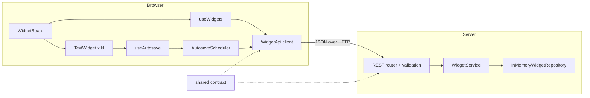

# Text Widgets — Trumpet Technical Challenge

A small web app modelled on a Trumpet "pod": add as many plain-text widgets as you like, type into each one independently, and the text is saved to the backend automatically when you stop typing. Reload the page and every widget comes back with exactly the same text. Widgets can also be deleted.

- **Frontend:** React 19 + Vite 8 (TypeScript), minimal plain CSS
- **Backend:** Node.js + Express 5 (TypeScript), in-memory storage
- **Shared:** one contract package (types, zod schemas, limits) used by both sides
- **Tests:** Vitest — 258 tests across shared, server and web
- **Packaging:** multi-stage Docker image, one command to run

---

## Contents

1. [Quick start](#quick-start)
2. [Running locally](#running-locally)
3. [Running the tests](#running-the-tests)
4. [How it works](#how-it-works)
5. [Key decisions](#key-decisions)
6. [API](#api)
7. [Project structure](#project-structure)
8. [Tradeoffs](#tradeoffs)
9. [With more time](#with-more-time)
10. [AI-assisted workflow and prompts](#ai-assisted-workflow-and-prompts)

---

## Quick start

With Docker:

```bash
docker compose up --build
```

Open <http://localhost:3000>. The container serves both the web app and the API on port 3000 and reports itself healthy via `GET /api/health`.

To run the full test suite inside Docker instead:

```bash
docker build --target test .
```

## Running locally

**Prerequisites:** Node.js **22.12 or newer** (24 LTS recommended; `.nvmrc` is provided) and npm 10+.

```bash
npm install          # install all workspaces

npm run dev          # API on :3001 + Vite dev server on :5173 (open http://localhost:5173)

npm run build        # build the web app and the server bundle
npm start            # serve the production build on http://localhost:3000
```

In development, Vite proxies `/api` to the API server, so the browser only ever talks to one origin. In production the Express server serves the built web app itself. In both cases there is no CORS configuration to get wrong.

The server can be configured with flags or environment variables (flags win):

| Flag | Env var | Default |
|------|---------|---------|
| `--port` | `PORT` | `3001` (`npm start` passes `3000`) |
| `--static-dir` | `STATIC_DIR` | `apps/web/dist` if a build exists, otherwise API only |

## Running the tests

```bash
npm test             # all 258 tests (shared, server, web) in one run
npm run test:watch   # watch mode
npm run typecheck    # strict TypeScript across all packages
```

| Package | Tests | What is covered |
|---------|------:|-----------------|
| `packages/shared` | 26 | Validation schemas: 1k/10k/50k-character text, Unicode, invalid input, UUIDs |
| `apps/server` | 86 | Repository, service, every endpoint and error mapping, full end-to-end API flows, static hosting, config |
| `apps/web` | 146 | UI components, API client, autosave scheduler (fake timers), hooks, the widget, the board, and full user flows against an in-memory fake API (including "type → reload → same text") |

Two of the web tests deserve a mention:

- **Render cost.** With 50 widgets holding 10,000 characters each, typing in one widget re-renders only that widget.
- **Mutation-checked.** Several tests were verified by deliberately breaking the code and confirming they fail. Examples: counting length in code points instead of UTF-16 units, saving on every keystroke, removing `memo`, and restoring a failed delete in the wrong place.

---

## How it works



1. **Load.** On page load the board fetches `GET /api/widgets` and renders every widget in creation order with its saved text (loading, error-with-retry and empty states included).
2. **Add.** "Add widget" calls `POST /api/widgets`. The server creates the widget with a UUID and persists it immediately, so even an empty widget survives a reload.
3. **Type.** Each widget keeps its own draft locally and hands every change to the `AutosaveScheduler`.
4. **Save.** When the user is "done typing", only that widget's text is sent with `PATCH /api/widgets/:id`. A status label shows *Unsaved changes → Saving… → Saved*, or *Save failed* with a retry button.
5. **Delete.** The widget disappears immediately and its pending save is cancelled. If the server call fails, it is restored in the same position with the user's latest text.

## Key decisions

**What "done typing" means.** A widget is saved after **800 ms without a keystroke**, or **immediately when the textbox loses focus**. Nothing is sent while the user is still typing, and nothing is sent if the text equals what was last saved (including when the user types and then undoes their change).

**The latest text always wins.** Network responses can arrive out of order. Rather than adding versioning on the server, the scheduler allows **at most one save in flight per widget**. Saves requested during that time collapse into a single follow-up carrying the newest text. If the user is simply still typing, the follow-up waits for the normal pause instead of saving half-finished words.

**Nothing is lost on reload or tab close.** When the page is hidden or unloaded, every unsaved widget is flushed with `fetch(..., { keepalive: true })` so the request outlives the page. Browsers cap keepalive bodies at 64 KiB, so very large texts fall back to a normal request.

**Typing is cheap, however many widgets there are.** A widget's draft lives in that widget, not in a global store. A keystroke causes one state update in one memoised component, and the board never re-renders. On the server, a `Map` gives O(1) get/update/delete and also keeps creation order, so no separate index is needed.

**Large text.** The limit is 50,000 characters per widget, well above the 1,000 the brief asks for. The limit is counted in UTF-16 code units, exactly like the browser's `maxlength`, so the client and server agree on emoji (an emoji counts as 2). zod 4's `.max()` counts code points, so the shared schema checks `String.length` explicitly. JSON bodies are capped at 512 KB, which covers the worst case of 50,000 escaped control characters.

**One contract, two consumers.** `packages/shared` defines the `Widget` type, request schemas, error codes and the length limit. The server validates every request with these schemas before it reaches business logic. The client uses the same types, so the two sides cannot drift apart.

**Errors are values, not exceptions.** The API client returns `Result<T, ApiError>` and never throws. The server returns one error shape for every failure: `{ error: { code, message, details? } }` with `400 / 404 / 413 / 500`. Unexpected errors are logged on the server and returned to the client only as a generic message.

**Reusable UI.** `Button`, `TextArea`, `WidgetFrame` (the bordered container), `StatusIndicator` and `Alert` are generic components with accessible labels. `WidgetFrame` can host any future widget type, such as video or images.

**Delete that undoes cleanly.** A widget being deleted is hidden, not removed, until the server confirms. If two deletes fail at once, each widget reappears exactly where it was.

## API

All bodies are JSON. Errors always use `{ "error": { "code", "message", "details"? } }`.

| Method | Path | Body | Success | Errors |
|--------|------|------|---------|--------|
| `GET` | `/api/widgets` | — | `200 { widgets: Widget[] }` (creation order) | 500 |
| `POST` | `/api/widgets` | optional `{ text?: string }` | `201 Widget` | 400, 413 |
| `PATCH` | `/api/widgets/:id` | `{ text: string }` | `200 Widget` | 400, 404, 413 |
| `DELETE` | `/api/widgets/:id` | — | `204` | 400, 404 |
| `GET` | `/api/health` | — | `200 { status: "ok" }` | — |

`Widget` is `{ id: string (UUID), text: string, createdAt: ISO string, updatedAt: ISO string }`.

## Project structure

```
apps/
  server/            Express API
    src/
      app.ts           composition root (createApp)
      index.ts         entry point + config resolution
      routes/          REST router
      services/        widget lifecycle rules
      repositories/    storage port + in-memory adapter
      middleware/      validation, error envelope, static hosting
  web/               React SPA
    src/
      api/             typed client + app-wide providers
      autosave/        AutosaveScheduler (framework-independent)
      hooks/           useWidgets (board state), useAutosave (per widget)
      components/ui/   reusable primitives
      components/widgets/  TextWidget, WidgetBoard
packages/
  shared/            types, zod schemas, limits, error codes
.sdd/                the spec this was built from (requirements, design, tasks)
```

---

## Tradeoffs

- **In-memory storage.** This follows the brief's tip and keeps the app dependency-free, but data is lost when the server restarts. Storage sits behind a `WidgetRepository` interface, so swapping in SQLite or Postgres touches one file.
- **Single user, last write wins.** There are no accounts or pods. Two tabs editing the same widget overwrite each other. Within one tab, saves are strictly ordered.
- **Server-generated IDs.** A new widget appears after one round trip rather than instantly. This keeps the API simple, since the server never has to trust client IDs. Clicks are never blocked, and a pending indicator shows while creates are in flight.
- **Debounce plus blur rather than an explicit Save button.** This matches the brief's "when a user is done typing" with no extra UI. The cost is up to 800 ms during which a crash, as opposed to a normal close or reload, could lose a few keystrokes.
- **Test depth over browser E2E.** User flows are tested in jsdom against a realistic in-memory fake API, plus a real HTTP test suite on the server. There are no Playwright or Cypress tests yet.
- **No list pagination.** `GET /api/widgets` returns everything. That is fine at pod scale, but it is O(n).

## With more time

- Durable storage (SQLite or Postgres adapter) and a `version` field so concurrent edits return `409 Conflict` instead of silently overwriting.
- Real-time sync between tabs and collaborators over WebSockets or Server-Sent Events.
- Multiple pods and authentication, with per-pod widget lists.
- Drag-and-drop reordering, and more widget types (YouTube, images) reusing `WidgetFrame`.
- Playwright end-to-end tests in CI (GitHub Actions running typecheck, tests and the Docker build).
- Offline support: queue saves while offline and retry with backoff when the connection returns.
- Rate limiting and structured request logging on the API.

---

## AI-assisted workflow and prompts

This project was built with **Claude Code** using a **spec-driven development (SDD)** workflow. The specification lives in [`.sdd/specs/text-widgets/`](.sdd/specs/text-widgets/):

| File | Content |
|------|---------|
| `requirements.md` | 10 requirement areas and 62 acceptance criteria in EARS format |
| `research.md` | Version checks, design options considered, risks |
| `design.md` | Architecture, interfaces, data model, error handling, test strategy |
| `tasks.md` | 18 sub-tasks, implemented one at a time |

Each phase was reviewed by me before moving on. Each task was implemented test-first (red → green → refactor) and committed by me with a message drafted by the assistant.

The prompts used, in order:

```text
/sdd:spec-init "Trumpet Technical Challenge 2026.pdf"   # spec initialised from the challenge brief
/sdd:spec-requirements text-widgets                     # requirements in EARS format
/sdd:spec-design text-widgets -y                        # technical design + research log
/sdd:spec-tasks text-widgets -y                         # implementation plan (18 tasks)
/sdd:spec-impl text-widgets 1.1                         # then one prompt per task:
/sdd:spec-impl text-widgets 1.2                         #   1.2, 2.1–2.4, 3.1–3.4, 4.1–4.5, 5.1
...
"dont commit anything moving forward just give me the commit message"
"I tested it out can you work on 5.2 and 5.3"           # Docker + this README
```

Things the AI flagged or corrected along the way, which I kept because they improved the result:

- **zod's length rule:** zod 4's `.max()` counts code points, not UTF-16 units, so the schema uses an explicit `String.length` check.
- **Version pin:** jsdom was pinned to 28.x because jsdom 30 requires a newer Node 22 than the one available locally.
- **Testing Library and fake timers:** Testing Library needed a small shim to work with Vitest's fake timers.
- **A test that couldn't fail:** a render-count test was rewritten after a mutation check showed it passed even without `memo`.
